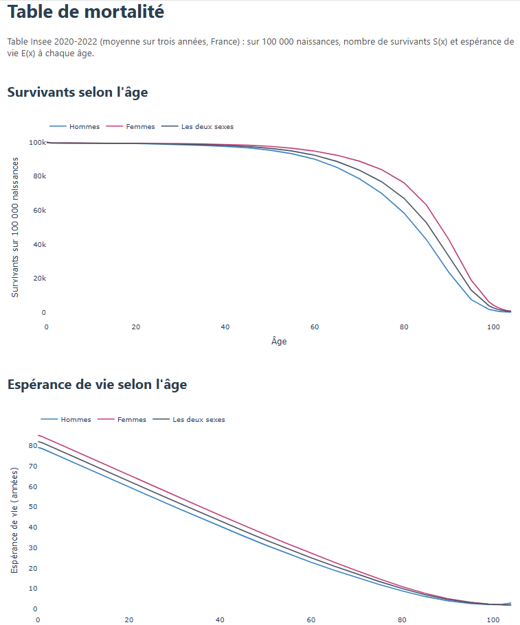
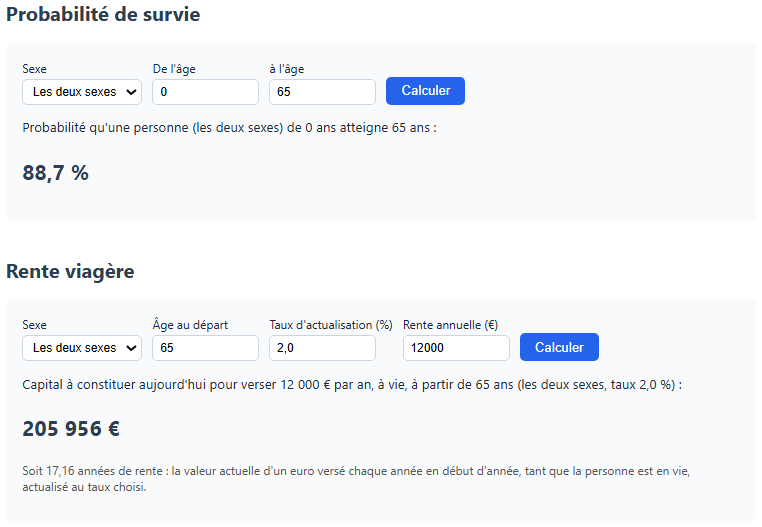
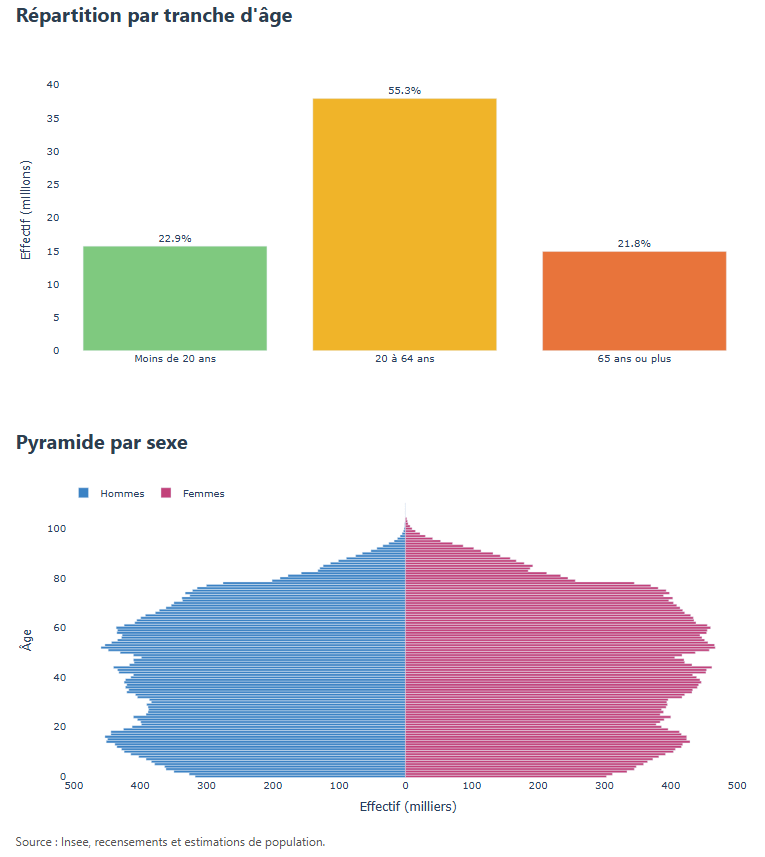

# Tables de mortalité et calculs actuariels


> 🇬🇧 *A Flask web app built on official French mortality tables (Insee): survival curves and life expectancy by sex, survival probabilities and life-annuity pricing. Every calculation is checked against the values Insee publishes.*

## Pourquoi ce projet

J'ai écrit ce programme pour **comprendre ce qu'est une table de mortalité** : ce que signifient le nombre de survivants S(x) et l'espérance de vie E(x), et comment on passe de l'un à l'autre. Le point de départ était un entretien à la Direction de la Sécurité sociale (DSS). Le plus sûr moyen de comprendre ces notions était de les coder, puis de vérifier que mes calculs retombaient sur les chiffres de l'Insee.

Je l'ai ensuite retravaillé pour en faire un petit outil actuariel, testé et sécurisé.

| Survie et espérance de vie | Calculs actuariels | Pyramide des âges |
|---|---|---|
|  |  |  |

## Les notions en bref

- **S(x), les survivants :** sur 100 000 naissances, combien de personnes sont encore en vie à l'âge x. Exemple : S(65) = 88 716, donc 88,7 % des personnes atteignent 65 ans.
- **E(x), l'espérance de vie à l'âge x :** le nombre moyen d'années qu'il reste à vivre à une personne qui a atteint l'âge x. On l'obtient en additionnant toutes les années vécues après x par les survivants, puis en divisant par S(x). E(0) correspond à l'espérance de vie à la naissance (82,1 ans), mais une personne de 65 ans peut encore espérer vivre 21 ans, et non 17 : elle a déjà « survécu » aux risques des âges précédents.
- **q(x), la probabilité de décès :** la part des survivants à l'âge x qui décèdent avant l'âge suivant de la table.
- **Probabilité de survie de x à y :** S(y) / S(x).
- **Rente viagère :** la somme à placer aujourd'hui pour verser 1 € par an tant que la personne est en vie. Chaque versement futur est pondéré par la probabilité d'être encore en vie à ce moment-là, et actualisé, car 1 € dans 10 ans vaut moins que 1 € aujourd'hui. C'est le calcul de base des retraites et des contrats d'assurance vie.

## Ce que fait l'application

**Table de mortalité 2020-2022 (Insee)**
- Courbes de survie et d'espérance de vie pour les hommes, les femmes et l'ensemble.
- **Probabilité de survie** d'un âge à un autre. Par exemple, une personne née en 2020-2022 a 88,7 % de chances d'atteindre 65 ans.
- **Rente viagère :** le capital à mettre de côté aujourd'hui pour verser une rente annuelle à vie, selon l'âge, le sexe et le taux d'actualisation. C'est le calcul au cœur des retraites et de l'assurance vie.
- **Table détaillée :** probabilité de décès entre deux âges, espérance de vie publiée par l'Insee, espérance de vie recalculée et écart entre les deux.

**Pyramide des âges au 1er janvier 2025 (Insee)**
- Pyramide par sexe et répartition en trois tranches (moins de 20 ans, 20-64 ans, 65 ans ou plus).

On peut aussi **importer un autre tableau Insee** au même format, par exemple une table plus récente.

## Des calculs vérifiés contre la référence officielle

La table de l'Insee ne donne que certains âges (0, 1, 5, 10…, 95, 99-104). Entre deux âges publiés, le module `actuariat.py` relie les points par des droites. Au-delà de 104 ans, il prolonge la courbe pour retrouver l'espérance de vie publiée à cet âge. Les tests confrontent ensuite les résultats aux chiffres de l'Insee :

| Vérification | Résultat |
|---|---|
| Probabilité d'atteindre 65 ans (deux sexes) | 0,88716, identique à la note de lecture de l'Insee |
| Espérance de vie recalculée à partir des seuls survivants | écart < 0,1 an jusqu'à 80 ans, < 0,3 an au-delà |
| Rente viagère à taux nul | égale à l'espérance de vie + ½ an, comme attendu pour une rente versée en début d'année |

C'est la même démarche que mon module de calcul actuariel à la DSS, dont les tests étaient vérifiés contre un simulateur officiel.

## Sécurité

Comme l'application accepte des fichiers envoyés par des utilisateurs :
- les fichiers importés sont lus **en mémoire** et ne sont jamais écrits sur le disque. Un nom piégé comme `../../app.py` ne peut donc rien écraser ;
- la taille est limitée à 2 Mo, l'extension et le contenu sont contrôlés, et un tableau incohérent (âges non croissants, survivants qui augmentent, « Mixte » ≠ femmes + hommes) est refusé avec un message clair ;
- le mode debug de Flask est désactivé, car sa console permet d'exécuter du code à distance ;
- tous les paramètres sont validés (âges, taux, montants), et le nom de fichier affiché est échappé.

Ces cas sont couverts par les tests (`tests/test_app.py`).

## Lancer le projet

```bash
pip install -r requirements.txt
python app.py      # puis ouvrir http://127.0.0.1:5000
pytest             # 36 tests
```

## Structure

```
actuariat.py      lecture des tableaux Insee et calculs (sans Flask, testable seul)
app.py            routes Flask et graphiques Plotly
templates/        pages HTML (Jinja)
data/             tableaux Insee d'origine
tests/            tests des calculs et de l'application
```

## Sources

- [Table de mortalité 2020-2022 — Ined / Insee](https://www.ined.fr/fr/tout-savoir-population/chiffres/france/mortalite-cause-deces/table-mortalite/)
- Pyramide des âges au 1er janvier 2025 — Insee, bilan démographique 2025 (figure 6a)

---
Hugues Barbier, data scientist Python freelance : automatisation Excel, ETL et fiabilisation de données.
